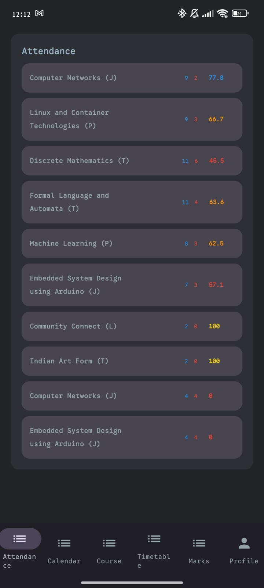
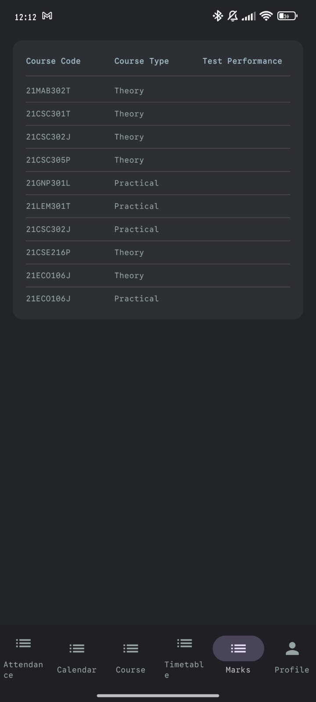
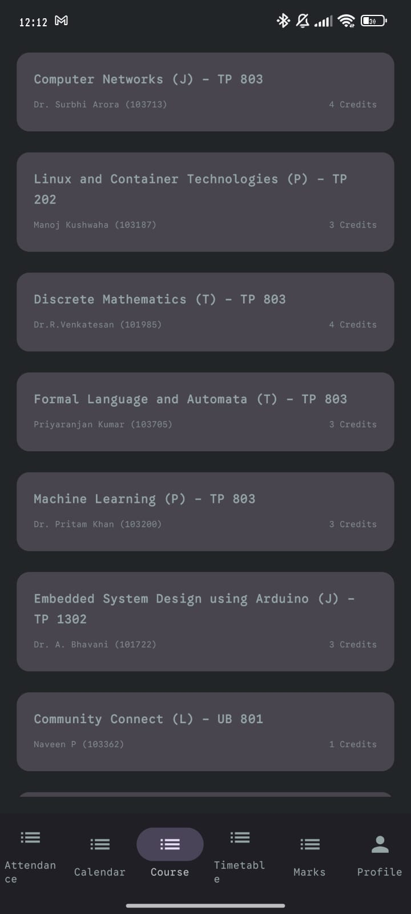
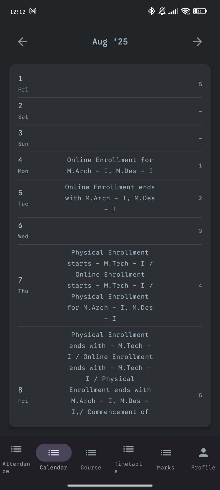
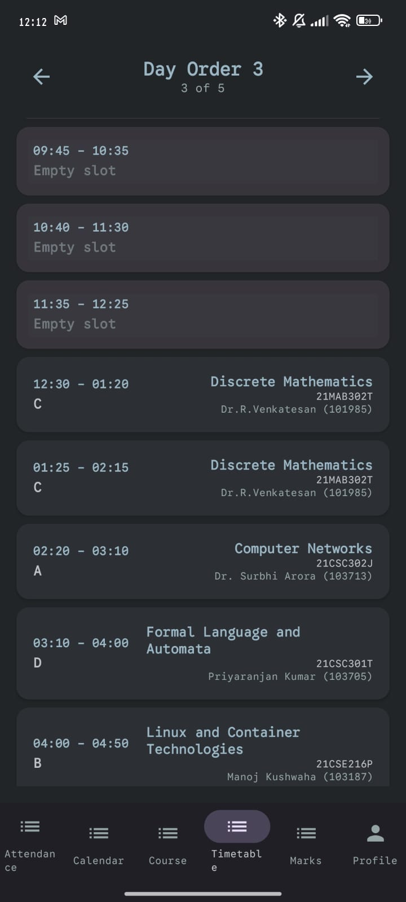

<p align="center">
  
  <h1 align="center">Vihla: An SRM Academia Wrapper</h1>
</p>

A lightweight native Android wrapper for academia.srmist.edu.in, built with Kotlin to deliver a faster, cleaner mobile experience while preserving all academic functionality.  

## Download

You can download the latest APK from the [releases page](https://github.com/veradec/vihla/releases).

## ✨ Features

- 🚀 Native Android interface optimized for Academia.edu
- 📱 Mobile-first design with smooth navigation
- 🎨 Material You dynamic theming
- 🌙 Dark mode support
- 🔒 Secure authentication with token refresh
- 🔔 Notification system
- 🔄 Background sync

## 📸 Screenshots

<div align="center">
    
    
    
    
    
</div>

## 📋 Requirements

- Android 9.0 (API 28) or higher
- Active Academia account
- Internet connection

## ⬇️ Installation

### From Releases
1. Download the latest APK from [Releases](https://github.com/veradec/vihla/releases)
2. Enable "Install unknown apps" for your browser/file manager
3. Install the downloaded APK

### From Source
```bash
git clone https://github.com/veradec/vihla.git
cd vihla
./gradlew assembleDebug
```

## 🗺️ Roadmap

- **Google Classroom Integration**: Sync assignments, grades, and announcements.
- **Student Portal Integration**: Access student portal features.
- **Attendance Insights**: Set required attendance margins and receive alerts.
- **Class Notifications**: Get timely reminders for each class with attendance status.

## 🙏 Acknowledgements

This project is a Kotlin rewrite of the original [SRM Academia API](https://github.com/jackwaghan/srm-academia-api) by [Jack Waghan](https://github.com/jackwaghan). 

Key improvements in this version include:
- Complete Kotlin implementation
- Modern Android architecture components
- Enhanced error handling
- Improved performance
- Additional features specific to mobile usage

We're grateful for the foundational work done on the original project that made this implementation possible.<!-- chore: add proguard rules for release build [2025-12-01] -->
<!-- feat: add attendance percentage calculation [2025-12-03] -->
<!-- fix: attendance count off by one on first day [2025-12-03] -->
<!-- refactor: move attendance logic into AttendanceUtil [2025-12-03] -->
<!-- feat: add marks entry screen with subject list [2025-12-05] -->
<!-- fix: marks screen not scrolling on small devices [2025-12-05] -->
<!-- chore: update compileSdk to 35 in build.gradle [2025-12-08] -->
<!-- feat: add timetable day highlight for current day [2025-12-10] -->
<!-- fix: timetable highlight not updating at midnight [2025-12-10] -->
<!-- refactor: extract timetable slot view into component [2025-12-10] -->
<!-- chore: add placeholder for empty timetable state [2025-12-10] -->
<!-- feat: add profile screen with cached user details [2025-12-13] -->
